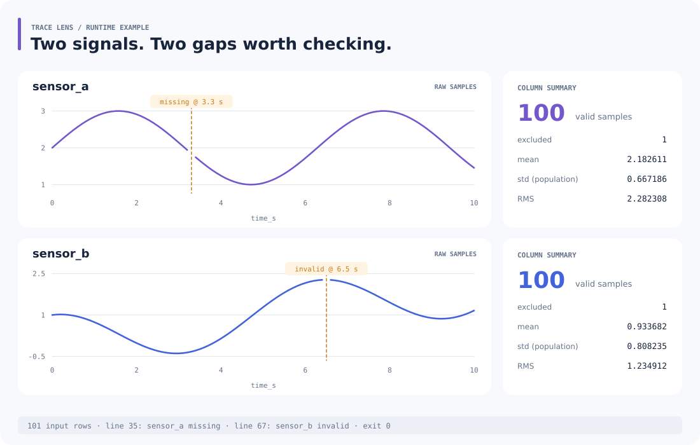

<p></p>

# Trace Lens

把 CSV 时间序列整理成曲线、逐列统计和 HTML 报告。支持基线扣除，缺失或无效样本会在曲线上留出断点，便于回查原始数据。

## 看一个例子

仓库样例有 101 行、两路信号。`sensor_a` 在 3.3 秒缺值，`sensor_b` 在 6.5 秒包含无效文本；两列各有 100 个有效样本。



图中曲线来自 `examples/signals.csv`，统计与行号来自实际运行生成的 [JSON 报告](assets/demo-stats.json)。复现命令：

```sh
python -m trace_lens report examples/signals.csv --x time_s --out output
```

需要 Python 3.10+，在项目根目录运行，无第三方依赖。浏览器打开 `output/report.html` 即可查看完整报告，也可先打开仓库内的 [示例报告](examples/demo-report/report.html)。

每次生成：

- `report.html`：内嵌全部曲线的独立报告。
- `stats.json`：逐列统计、基线参数、数据诊断。
- `trace-001.svg`、`trace-002.svg`：可单独使用的曲线图。

输出目录必须是新目录；再次运行时换一个 `--out` 路径。

## 选择列与扣除基线

```sh
python -m trace_lens report examples/signals.csv --x time_s \
  --columns sensor_a sensor_b --baseline 0 1 --out corrected
```

`--baseline START END` 取闭区间内各列有效样本的均值，再从整列减去该值。报告保存每列扣除的均值；原文件保持不变。区间内没有有效样本会报错。

要生成新的演示数据：

```sh
python -m trace_lens sample sample.csv
python -m trace_lens report sample.csv --x time_s --columns sensor_a --out single-channel
```

## 数据约定

- 输入为带表头的 UTF-8 CSV（兼容 BOM）；列名唯一，行宽一致。
- `--x` 是数值横坐标，如秒数。未指定 `--columns` 时，其余列全部按数值信号处理。
- 空值记为 `missing`，非数值记为 `invalid`，NaN/Inf 记为 `nonfinite`。诊断包含 CSV 行号和列名。
- x 无效时排除整行；单个信号无效时只排除该信号。曲线在这些位置断开。
- 保留输入顺序，x 递减时给出警告；允许重复 x。
- 输出 count、excluded、min、max、mean、std、rms。std 使用总体标准差；启用基线时统计校正后的数据。
- 没有有效样本的列，count 为 0，数值统计为 JSON `null`。

退出码 `0` 表示成功，`2` 表示参数、输入或写入错误。缺值等诊断写到 stderr 和 JSON；仍有有效数据时可以正常生成报告。

## 开发

```sh
python -m unittest discover -s tests -v
```

`core.py` 处理 CSV、统计和基线；`report.py` 生成 SVG/HTML；`__main__.py` 提供 CLI。

数据和诊断在内存中处理，每个有效点都参与绘图，适合数万行以内的文件。计算采用双精度浮点；日期解析、滤波或重采样可在导入前完成。
